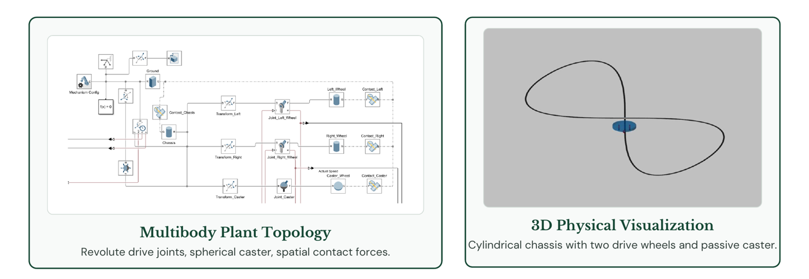
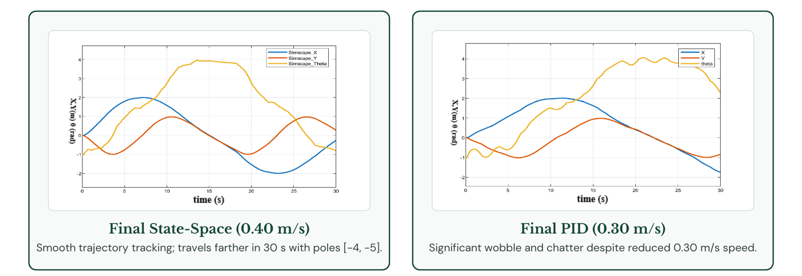

# PID vs. State-Space Control of a Differential-Drive Line Follower

Mechatronics project, University of Debrecen · Supervisors: Kis Károly Árpád, Dr. Hajdu Sándor 
This is the groundwork for my B.Sc. thesis on mobile-robot path tracking.

## Question

Controllers that look great on an ideal kinematic model often fall apart once motors, drivers and batteries are added. I wanted to know which holds up better as the model gets more realistic: a classic decoupled **PID** or **state-space pole placement with a Luenberger observer**.

The robot follows a figure-8 line using a 6-sensor IR array.

## Approach

I added realism one layer at a time and re-ran both controllers at each stage:

| Stage | What was added | Models |
|---|---|---|
| 1 | 3-DoF unicycle kinematics, validated against the reference block | `DDMR_OpenLoop.slx` |
| 2 | Parallel PID (heading + braking/speed loops) | `DDMR_PID.slx`, `DDMR_PID_Simplified.slx` |
| 2b | State-space pole placement + Luenberger observer | `DDMR_SS.slx` |
| 3 | Simscape Multibody plant: chassis, revolute drive joints, spherical caster, contact forces | `DDMR_Simscape*.slx` |
| 4 | Cascaded DC motor models with inner velocity PIDs | `*_Motor.slx` |
| 5 | H-bridge PWM drivers and a non-ideal battery | `*_Motor_HBridge.slx` |
| + | LQR gains and an LQR-designed observer as a follow-up to pole placement | `LQR.m` |

## Result

- On the **ideal kinematic model**, PID tracks well and looks like the better choice.
- With **motors, H-bridge and battery** in the loop, PID started to wobble and chatter. I had to cut its speed to **0.30 m/s** to keep it on the track.
- The **state-space controller** (steering poles at −4, −5) held **0.40 m/s** with smooth tracking and covered more of the track in the same 30 s.

My takeaway is that full-state feedback copes with actuator lag much better than independently tuned PID loops. The ideal model hides that difference.

## Running it

MATLAB R2024b or newer with Simulink, Simscape and Simscape Multibody.

1. Run `Track2.m` (or `Track.m`) to load the robot and track parameters into the workspace.
2. Open any `DDMR_*.slx` model and press Run.
3. `LQR.m` computes the LQR controller and observer gains for the state-space models.

Track geometry for the 3D visualisation is in `models/track/`.

## Documents

- [`docs/DDMR_Paper.pdf`](docs/DDMR_Paper.pdf): the write-up (derivations, controller design, results)
- [`docs/DDMR_Presentation.pdf`](docs/DDMR_Presentation.pdf): the slide deck

---
Part of [Mohammed Emad's engineering portfolio](https://github.com/Mohammed-Emad-2004).
